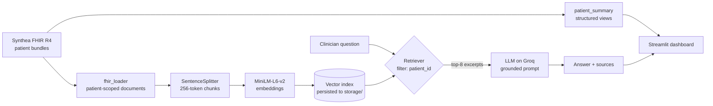

# 🩺 Medical RAG Assistant

[](https://github.com/iMalcolmS/medical-rag-assistant/actions/workflows/tests.yml)


A clinician-facing dashboard for exploring a patient's record, with a **retrieval-augmented AI assistant** that answers questions **only from that patient's data** and shows the record excerpts behind every answer.

Built on synthetic **FHIR R4** records generated by [Synthea](https://github.com/synthetichealth/synthea), **LlamaIndex**, **Hugging Face** embeddings and an open-weight LLM served by **Groq**.


> ⚠️ **Portfolio project, not a medical device.** All data is synthetic. Do not use for clinical decisions.

---

## Contents

- [Features](#features)
- [Architecture](#architecture)
- [Design decisions](#design-decisions)
- [Results](#results)
- [Project structure](#project-structure)
- [Getting started](#getting-started)
- [Configuration](#configuration)
- [Limitations](#limitations)
- [Roadmap](#roadmap)

---

## Features

**Patient chart**
- Patient header with age, last encounter and **allergies highlighted** (with icon and text, never colour alone)
- Health-style tiles for blood pressure, BMI, heart rate and HbA1c: latest value, change since the previous reading and a trend sparkline
- Problems (clinical and social history, active and resolved), medication history grouped by drug, interactive trend charts and a year-by-year timeline

**AI assistant**
- Free-text questions about the selected patient, e.g. *"Which medications are currently active?"*
- **Patient-scoped retrieval**: the model only ever sees the selected patient's records
- **Grounded answers**: when the record does not contain the answer, the assistant says so instead of guessing
- Every answer lists the **source excerpts** and their similarity scores

---

## Architecture



| Module | Responsibility |
|---|---|
| `src/fhir_loader.py` | Parses FHIR bundles into documents grouped by meaning (demographics, conditions, social history, medications, one per observation type), each tagged with the patient ID |
| `src/rag_pipeline.py` | Builds and persists the vector index, applies the patient filter and the grounded prompt |
| `src/patient_summary.py` | Structured data for the dashboard: header, allergies, problem list, medication list, vital-sign series, timeline |
| `app.py` | Streamlit interface |

---

## Design decisions

| Decision | Why |
|---|---|
| **Filter retrieval by `patient_id` metadata** | An early version retrieved from all patients at once, so answers could mix records from different people. Filtering at retrieval time means the LLM never sees another patient's data. |
| **Group FHIR resources by meaning, not one document per resource** | A question like *"Which conditions does the patient have?"* is answered from one complete list instead of scattered fragments. |
| **Separate social history from clinical conditions** | Synthea stores employment or education as `Condition` resources. Without separation, the assistant could answer "full-time employment" when asked about diseases. Classified with a documented keyword list, since Synthea also tags clinical findings such as prediabetes with "(finding)". |
| **Group repeat prescriptions** | Synthea creates a new prescription for every renewal (15 identical lines for one statin). One line per drug with first and last date is shorter and easier to retrieve. |
| **256-token chunks** | `all-MiniLM-L6-v2` only embeds the first 256 word pieces; longer chunks would be silently truncated. |
| **The patient UUID is kept out of the embedded text** | It is needed for filtering but carries no meaning, so it would only add noise to similarity search. |
| **Grounded prompt with an explicit refusal sentence, temperature 0** | Deterministic answers that say *"I could not find this information"* instead of hallucinating. |
| **Model name in `.env`, not in code** | Groq retires models regularly; switching model is a one-line configuration change. |
| **No automated "risk score"** | A keyword heuristic rated coronary heart disease as *low* risk and prediabetes as *high*. A wrong risk label is worse than none, so it was removed. |
| **Interface follows Apple's Human Interface Guidelines** | Clinical software is often dense and dated. The dashboard uses clear hierarchy, grouped lists, translucent surfaces and colour-blind-safe chart colours, and respects the system settings for reduced motion, reduced transparency and increased contrast. |
| **Tests run with mock models** | The test suite needs no API key, no model download and no patient data, so CI installs two packages and runs in about a minute. |

---

## Results

Manual checks on real Synthea patients:

| Question | Behaviour |
|---|---|
| *Which chronic conditions does the patient have?* | Lists only the active conditions with onset dates; resolved episodes are excluded |
| *What medications has the patient been prescribed for heart disease?* | Returns the cardiovascular drugs with prescription periods and counts |
| *What is the patient's blood type?* (not recorded by Synthea) | *"I could not find this information in the patient's record."* |
| Any question | All retrieved excerpts belong to the selected patient |

A formal evaluation set with accuracy and refusal metrics is on the [roadmap](#roadmap).

---

## Project structure

```
medical-rag-assistant/
├── app.py                     # Streamlit dashboard
├── src/
│   ├── fhir_loader.py         # FHIR bundles -> patient-scoped documents
│   ├── rag_pipeline.py        # Index, patient filter, grounded prompt
│   └── patient_summary.py     # Structured views for the dashboard
├── tests/                     # pytest suite with synthetic bundles and mock models
├── .streamlit/config.toml     # Theme
├── .github/workflows/tests.yml
├── requirements.txt           # App dependencies (pinned)
├── requirements-dev.txt       # Test-only dependencies
├── .env.example
└── data/fhir/                 # Synthea bundles (not committed)
```

---

## Getting started

**Requirements:** Python 3.11, a free [Groq API key](https://console.groq.com/keys), and Java 17+ to generate synthetic patients with Synthea.

```bash
git clone https://github.com/iMalcolmS/medical-rag-assistant.git
cd medical-rag-assistant
python3.11 -m venv venv
source venv/bin/activate
pip install -r requirements.txt
cp .env.example .env          # then add your GROQ_API_KEY
```

**Generate synthetic patients** with [Synthea](https://github.com/synthetichealth/synthea) and copy the FHIR bundles into `data/fhir/`:

```bash
git clone https://github.com/synthetichealth/synthea.git
cd synthea && ./run_synthea -p 50
cp output/fhir/*.json ../medical-rag-assistant/data/fhir/
```

**Run the app:**

```bash
streamlit run app.py
```

The first run downloads the embedding model and indexes the records (a few minutes); later runs load the index from `storage/`.

**Run the tests:**

```bash
pip install -r requirements-dev.txt
python -m pytest -v
```

---

## Configuration

| Variable | Default | Purpose |
|---|---|---|
| `GROQ_API_KEY` | (required) | Groq API key |
| `GROQ_MODEL` | `openai/gpt-oss-120b` | Model served by Groq |
| `PATIENT_LIMIT` | `20` | Number of patients indexed on the first run. After changing it, delete `storage/` to rebuild the index |

---

## Limitations

- **Synthetic data only.** Synthea records are realistic in structure but simpler than real clinical notes; there is no free text.
- **Not validated for clinical use** and not a medical device.
- **English only.**
- **Social-history classification uses a keyword list**, not an official FHIR category.
- **Local, file-based vector index**, suitable for tens of patients rather than a hospital-scale deployment.
- The LLM can still make mistakes; the source excerpts are shown so every answer can be checked.

---

## Roadmap

- [ ] Evaluation set (~25 questions with known answers) measuring accuracy and correct refusals
- [ ] Public demo on Streamlit Community Cloud
- [ ] Docker image
- [ ] Inline citations linking each sentence of an answer to its source excerpt
- [ ] Hybrid search (keyword + vector) for exact codes and drug names

---

## Author

**Malcolm**: MSc Artificial Intelligence (First Class Honours), University of West London
[GitHub](https://github.com/iMalcolmS)
